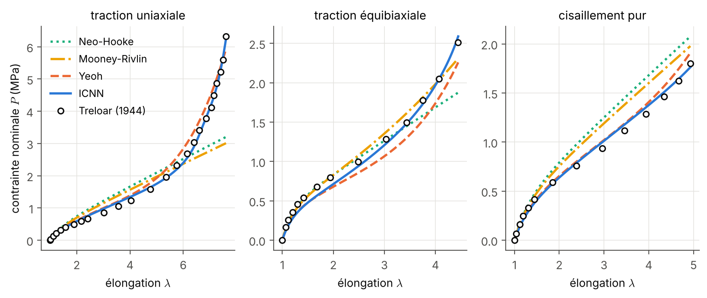

# jax-j2-gauss

**Loi élastoplastique J2 différentiable et vectorisée en JAX** : retour radial, tangente cohérente par différentiation automatique, intégration par lots CPU/GPU et potentiel hyperélastique neuronal.

```python
sigma_new, state_new = integrate(eps_new, state_old, params)          # un point de Gauss
C_tangent = jax.jacfwd(lambda e: integrate(e, state_old, params)[0])(eps_new)
batched = jax.jit(jax.vmap(integrate, in_axes=(0, 0, None)))          # N points de Gauss
```

- Plasticité de von Mises en petites déformations, notation de Mandel (vecteurs de taille 6).
- Écrouissage isotrope linéaire ou de Voce, cinématique de Prager.
- Newton local sur Δp dérivé par le **théorème des fonctions implicites** (`jax.custom_jvp`).
- Tangente AD = tangente cohérente de Simo–Hughes à **3·10⁻¹⁶** près ; différences finies à 4·10⁻¹¹.
- **77 tests** `pytest`, dont les pièges de JAX : `if` → `where`, NaN en mode inverse (« double `where` »), symétries mineures en 3×3.
- Rapport complet (27 pages, en français, avec rappels de mécanique et de mathématiques) : [`report/rapport.pdf`](report/rapport.pdf).

## Quatre figures

**1. La tangente cohérente donne une convergence quadratique… à condition de choisir le bon cas test.**


Avec l'écrouissage de Voce, l'ordre mesuré est 2,01 (tangente cohérente) contre 1,00 (tangente élastique, taux 0,130 prédit par le spectre de I − K_e⁻¹K_t). Avec un écrouissage **linéaire** en traction proportionnelle (courbe verte), la réponse est affine par morceaux : Newton converge en **une** itération, et on ne peut pas y voir la convergence quadratique.

**2. Écrouissage isotrope, cinématique et combiné en chargement cyclique.**


**3. GPU contre CPU sur une RTX 2050 : les plafonds mesurés (pointillés) prédisent les débits.**


**4. Un potentiel neuronal polyconvexe identifié sur les données de Treloar (1944).**



## Conclusions

1. **L'AD donne la tangente cohérente exacte** (écart 3·10⁻¹⁶ avec Simo–Hughes). La dérivation à la main devient un test, et n'est plus une étape du développement.
2. **Le `where` seul ne suffit pas** : il protège le mode direct, mais en mode inverse (identification de paramètres) 0·∞ donne NaN. Il faut le double `where`.
3. **JAX CPU est 3,5 à 4,5 fois plus rapide que NumPy**. Le noyau reste limité par la mémoire, avec un trafic 3,5 fois le minimum, car XLA le découpe en 12 fusions.
4. **GPU mesuré sur une RTX 2050 portable** : avec les données déjà sur la carte, le GPU est **2× plus rapide** que le CPU en FP64 et **4× en FP32**. Mais dès qu'on compte les transferts PCIe, il est **2 à 3× plus lent**, car l'envoi et le retour prennent près de 90 % du temps. Le FP64 de la carte vaut 1/52 de son FP32. Pour une interface code_aster ↔ JAXMat, il faut donc garder l'état des points de Gauss sur le GPU.
5. **Un réseau convexe en entrée (ICNN, 230 paramètres) reproduit les trois essais de Treloar à 3–6 % près** et prédit le cisaillement pur non vu à 12 % près, contre 21 % pour Yeoh et 55 % pour Mooney–Rivlin.

> Mesures GPU : portable Lenovo LOQ (i5-12450HX, RTX 2050 4 Go, JAX 0.12 + CUDA 13), résultats dans `benchmarks/results/*izanami*`. Les mesures CPU de la section 9.3 du rapport proviennent d'une machine virtuelle à 2 cœurs.

## Installation et reproduction

```bash
python3 -m venv .venv && source .venv/bin/activate
pip install -r requirements.txt            # pour le GPU : pip install -U "jax[cuda12]"
pytest -q                                   # 77 tests, ~30 s

cd scripts
python newton_convergence.py                # figure 1 + results/newton_convergence.csv
python hysteresis.py                        # figure 2
python tangent_accuracy.py                  # AD vs analytique vs DF, courbe en V
python fit_treloar.py                       # figure 3 + bonus hyperélastique
python make_notebooks.py                    # notebooks exécutés
cd ..

python benchmarks/bench_cpu_gpu.py --nmax 6.5          # NumPy, JAX CPU, JAX GPU (+ transferts), FP64/FP32
python benchmarks/plot_bench.py benchmarks/results/bench_*.csv --name bench_cpu
python benchmarks/gpu_model.py                          # modèle roofline RTX 2050

cd report && latexmk -xelatex rapport.tex
```

**Mesure sur GPU** : tout est prêt dans le dossier `gpu/` (installation automatique, diagnostic, benchmark par blocs, figures). Mode d'emploi : [`gpu/README_GPU.md`](gpu/README_GPU.md). En trois commandes : `bash gpu/setup_gpu.sh`, `source .venv-gpu/bin/activate`, `bash gpu/run_all.sh`.

## Structure

```
src/j2gauss/   mandel.py, j2.py, tangent.py, driver.py, j2_numpy.py, hyperelastic.py
tests/         test_tangent, test_elastic_limit, test_pitfalls, test_driver, test_hyperelastic
scripts/       études et figures
benchmarks/    bench_cpu_gpu.py, plot_bench.py, gpu_model.py, results/*.csv
gpu/           kit GPU : setup_gpu.sh, check_gpu.py, bench_gpu.py, plot_gpu.py, run_all.sh
notebooks/     newton_convergence.ipynb, hysteresis.ipynb
data/          treloar.csv (Treloar 1944, numérisation publique du dépôt jaxmat)
figures/       PDF + PNG
report/        rapport LaTeX (xelatex + polyglossia)
```
