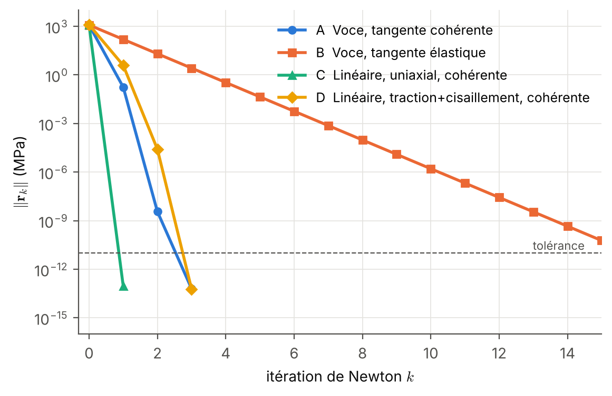
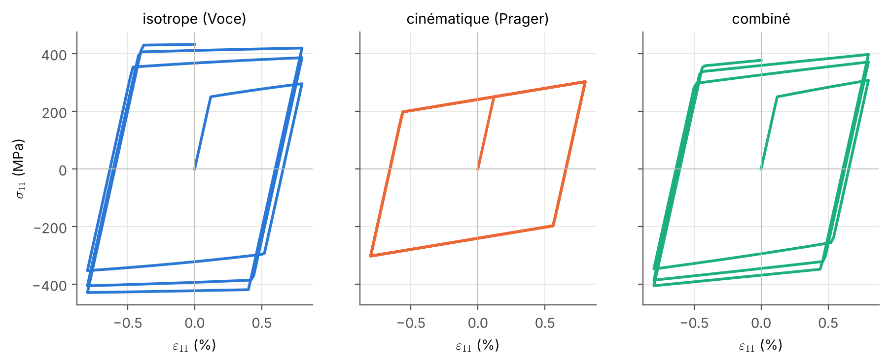
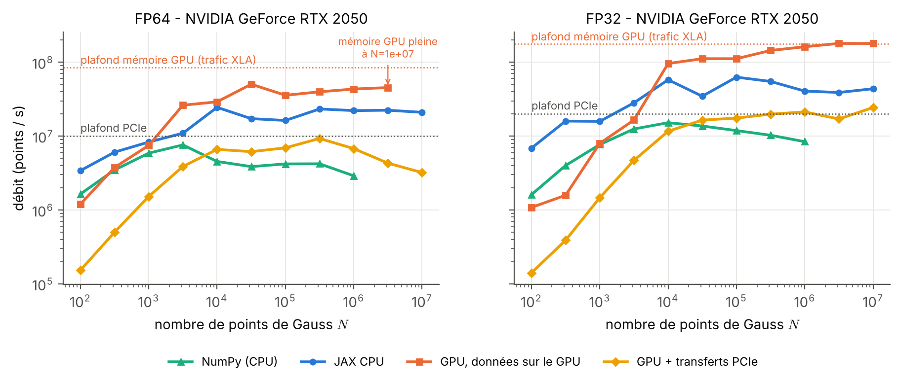

# jax-j2-gauss

**A differentiable, vectorized J2 elastoplastic law in JAX**: radial return, consistent tangent by automatic differentiation, batched CPU/GPU integration, and a neural hyperelastic potential.

```python
sigma_new, state_new = integrate(eps_new, state_old, params)          # one Gauss point
C_tangent = jax.jacfwd(lambda e: integrate(e, state_old, params)[0])(eps_new)
batched = jax.jit(jax.vmap(integrate, in_axes=(0, 0, None)))          # N Gauss points
```

- Von Mises plasticity in small strains, Mandel notation (vectors of size 6).
- Linear or Voce isotropic hardening, Prager kinematic hardening.
- Local Newton solve for Δp, differentiated with the **implicit function theorem** (`jax.custom_jvp`).
- AD tangent = Simo–Hughes consistent tangent up to **3·10⁻¹⁶**; finite differences up to 4·10⁻¹¹.
- **77 `pytest` tests**, including the JAX pitfalls: `if` → `where`, NaN in reverse mode ("double `where`"), minor symmetries with 3×3 matrices.
- Full report (27 pages, in French, with mechanics and math reminders): [`report/rapport.pdf`](report/rapport.pdf).

## Four figures

**1. The consistent tangent gives quadratic convergence… if you pick the right test case.**



With Voce hardening, the measured order is 2.01 (consistent tangent) against 1.00 (elastic tangent, rate 0.130, as predicted by the spectrum of I − K_e⁻¹K_t). With **linear** hardening under proportional tension (green curve), the response is piecewise linear: Newton converges in **one** iteration, so quadratic convergence cannot be seen there.

**2. Isotropic, kinematic and combined hardening under cyclic loading.**



**3. GPU vs CPU on an RTX 2050: the measured ceilings (dotted lines) predict the throughput.**



**4. A polyconvex neural potential fitted to the Treloar (1944) data.**


*(Figure labels are in French, like the report.)*

## Conclusions

1. **AD gives the exact consistent tangent** (difference of 3·10⁻¹⁶ with Simo–Hughes). Deriving the tangent by hand becomes a test, not a development step.
2. **A single `where` is not enough**: it protects forward mode, but in reverse mode (parameter identification) 0·∞ gives NaN. You need the double `where`.
3. **JAX on CPU is 3.5 to 4.5 times faster than NumPy**. The kernel stays memory-bound, with 3.5 times the minimum memory traffic, because XLA splits it into 12 fusions.
4. **GPU measured on an RTX 2050 laptop**: with the data already on the card, the GPU is **2× faster** than the CPU in FP64 and **4× faster in FP32**. But once PCIe transfers are counted, it is **2 to 3× slower**, because sending and returning the data take about 90 % of the time. The card's FP64 speed is 1/52 of its FP32 speed. So a code_aster ↔ JAXMat interface should keep the Gauss point state on the GPU.
5. **An input convex neural network (ICNN, 230 parameters) fits the three Treloar tests within 3–6 %** and predicts the unseen pure shear test within 12 %, against 21 % for Yeoh and 55 % for Mooney–Rivlin.

> GPU measurements: Lenovo LOQ laptop (i5-12450HX, RTX 2050 4 GB, JAX 0.12 + CUDA 13), results in `benchmarks/results/*izanami*`. The CPU measurements in section 9.3 of the report come from a 2-core virtual machine.

## Installation and reproduction

```bash
python3 -m venv .venv && source .venv/bin/activate
pip install -r requirements.txt            # for the GPU: pip install -U "jax[cuda12]"
pytest -q                                   # 77 tests, ~30 s

cd scripts
python newton_convergence.py                # figure 1 + results/newton_convergence.csv
python hysteresis.py                        # figure 2
python tangent_accuracy.py                  # AD vs analytic vs FD, V-shaped curve
python fit_treloar.py                       # figure 4 + hyperelastic bonus
python make_notebooks.py                    # executed notebooks
cd ..

python benchmarks/bench_cpu_gpu.py --nmax 6.5          # NumPy, JAX CPU, JAX GPU (+ transfers), FP64/FP32
python benchmarks/plot_bench.py benchmarks/results/bench_*.csv --name bench_cpu
python benchmarks/gpu_model.py                          # RTX 2050 roofline model

cd report && latexmk -xelatex rapport.tex
```

**GPU measurements**: everything is ready in the `gpu/` folder (automatic setup, machine check, chunked benchmark, figures). Guide: [`gpu/README_GPU.md`](gpu/README_GPU.md). In three commands: `bash gpu/setup_gpu.sh`, `source .venv-gpu/bin/activate`, `bash gpu/run_all.sh`.

## Structure

```
src/j2gauss/   mandel.py, j2.py, tangent.py, driver.py, j2_numpy.py, hyperelastic.py
tests/         test_tangent, test_elastic_limit, test_pitfalls, test_driver, test_hyperelastic
scripts/       studies and figures
benchmarks/    bench_cpu_gpu.py, plot_bench.py, gpu_model.py, results/*.csv
gpu/           GPU kit: setup_gpu.sh, check_gpu.py, bench_gpu.py, plot_gpu.py, run_all.sh
notebooks/     newton_convergence.ipynb, hysteresis.ipynb
data/          treloar.csv (Treloar 1944, public digitization from the jaxmat repository)
figures/       PDF + PNG
report/        LaTeX report (xelatex + polyglossia)
```
